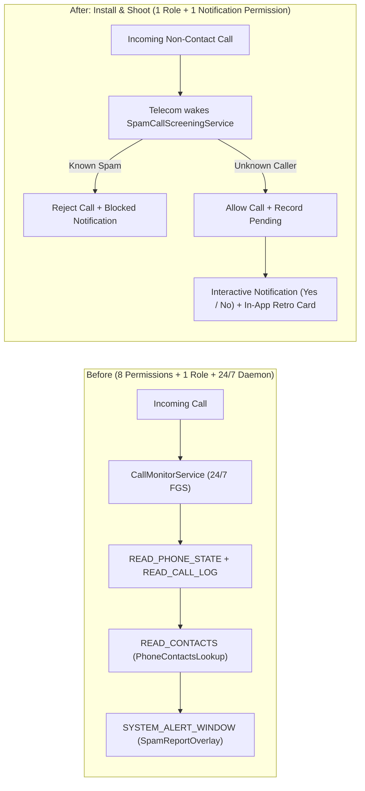

# Install & Shoot Permission Reduction Plan

## Goal Description

Currently, Mondafone requires **8 manifest permissions** (`READ_CALL_LOG`, `READ_PHONE_STATE`, `READ_CONTACTS`, `SYSTEM_ALERT_WINDOW`, `POST_NOTIFICATIONS`, `FOREGROUND_SERVICE`, `FOREGROUND_SERVICE_PHONE_CALL`, `MANAGE_OWN_CALLS`) plus `ROLE_CALL_SCREENING`, and runs a permanent 24/7 foreground daemon (`CallMonitorService`). Users must tap **"Grant access" three separate times** and navigate Android's restricted System Settings ("Display over other apps") before the app works.

This plan redesigns Mondafone into an **"Install and Shoot"** experience by leveraging Android's native `CallScreeningService` guarantees on `minSdk 31`:

1. **Remove `READ_CONTACTS` (Native Telecom Contact Filtering)**: On Android 10+ (`minSdk 31`), when a `CallScreeningService` does **not** hold `READ_CONTACTS`, Android's `TelecomManager` automatically skips contacts and **only** invokes `onScreenCall()` for numbers *not* in the user's contacts.
2. **Remove `READ_CALL_LOG`, `READ_PHONE_STATE`, and `CallMonitorService` (`FOREGROUND_SERVICE*`, `MANAGE_OWN_CALLS`)**: Instead of polling `CallLog` from a 24/7 foreground daemon, `SpamCallScreeningService` is woken up on-demand by Android Telecom for every unknown incoming call.
3. **Remove `SYSTEM_ALERT_WINDOW` (`SpamReportOverlay`)**: Replace the system overlay popup with:
   - **Interactive Notification Prompt** (`[ Yes ]` / `[ No ]` action buttons handled by a lightweight `BroadcastReceiver`) posted when an unknown call arrives.
   - **In-App Pending Review (`SpamReportView`)** inside `MainActivity`, allowing the user to classify pending unknown calls with the existing retro card UI directly in the app.
4. **Chained Single-Flow Onboarding**: Automatically chain the `ROLE_CALL_SCREENING` request and `POST_NOTIFICATIONS` request so setup completes in one continuous step.

---

## Architecture Comparison



| Requirement | Before | After | Reason |
| :--- | :---: | :---: | :--- |
| `ROLE_CALL_SCREENING` | Required | **Required** | Core Android role to screen and reject calls |
| `POST_NOTIFICATIONS` | Required | **Required** | Shows blocked call alerts & `[ Yes ]` / `[ No ]` verdict prompt |
| `READ_CALL_LOG` | Required | **Removed** | `SpamCallScreeningService` receives caller number & direction directly |
| `READ_CONTACTS` | Required | **Removed** | Android Telecom natively skips `onScreenCall` for contacts without this permission |
| `READ_PHONE_STATE` | Required | **Removed** | Prompt triggers on any unknown incoming call without waiting for call state |
| `SYSTEM_ALERT_WINDOW` | Required | **Removed** | Replaced by actionable notification + in-app `SpamReportView` |
| `FOREGROUND_SERVICE` | Required | **Removed** | No 24/7 background service needed |
| `FOREGROUND_SERVICE_PHONE_CALL` | Required | **Removed** | No 24/7 background service needed |
| `MANAGE_OWN_CALLS` | Required | **Removed** | Only existed for `FOREGROUND_SERVICE_PHONE_CALL` |

---

## Key Decisions

1. **Interactive Notification + In-App History**:
   - Eliminates `SYSTEM_ALERT_WINDOW` and the 24/7 `CallMonitorService` daemon.
   - When an unknown non-contact call arrives, `SpamCallScreeningService` records it as `pending` and sends an interactive notification with `Yes` / `No` actions, while `MainActivity` also shows `SpamReportView` for any pending numbers.
2. **Prompt on Any Unknown Incoming Call**:
   - Eliminates `READ_CALL_LOG` and `READ_PHONE_STATE`.
   - Even if the user rejects or ignores a spammer's call without answering, they can immediately mark the number as spam.
3. **Zero Background Battery Drain**:
   - `CallMonitorService` and its persistent notification (`"Watching ended calls"`) are completely removed. Android binds `SpamCallScreeningService` only when an incoming non-contact call arrives.

---

## Proposed Changes

### 1. Spam Domain & Storage (`dev.polyrics.mondafone.spam`)

#### [MODIFY] `app/src/main/java/dev/polyrics/mondafone/spam/SpamStore.kt`
- Add `addPending(number: String)` and `pendingNumbers(): List<String>` to `SpamStore` (with default implementations so existing test doubles stay minimal).
- When `mark(number, isSpam)` is called, the number moves from pending to decided (`spam` or `not_spam`).

#### [MODIFY] `app/src/main/java/dev/polyrics/mondafone/spam/PrefsSpamStore.kt`
- Store `"pending"` state in `SharedPreferences` when `addPending(number)` is called (only if `!isRegistered(number)`).
- Ensure `isRegistered(number)` returns `true` only when a verdict (`spam` or `not_spam`) has been recorded.
- Implement `pendingNumbers(): List<String>` returning all numbers currently in `"pending"` state.

#### [NEW] `app/src/main/java/dev/polyrics/mondafone/spam/SpamVerdictPromptNotifier.kt`
- Interface `SpamVerdictPromptNotifier` with `fun promptVerdict(number: String)`.
- Implementation `NotificationSpamVerdictPromptNotifier(context: Context)` that posts a notification asking `"Was this call spam?"` for `> number <` with two `Notification.Action` buttons (`Yes` / `No`) targeting `SpamVerdictReceiver`, and a content `PendingIntent` opening `MainActivity`.

#### [NEW] `app/src/main/java/dev/polyrics/mondafone/spam/SpamVerdictReceiver.kt`
- `BroadcastReceiver` handling `ACTION_MARK_SPAM` and `ACTION_MARK_NOT_SPAM` from the notification buttons:
  - Calls `PrefsSpamStore(context).mark(number, isSpam)`.
  - Cancels the prompt notification for that number.

#### [MODIFY] `app/src/main/java/dev/polyrics/mondafone/spam/SpamCallScreeningService.kt`
- Ignore outgoing calls (`if (callDetails.callDirection != Call.Details.DIRECTION_INCOMING) return`).
- Delegate decision logic:
  - If `store.isSpam(number)` -> block call + `notifier.notifyBlocked(number)`.
  - If `!store.isRegistered(number)` -> allow call + `store.addPending(number)` + `promptNotifier.promptVerdict(number)`.
  - Otherwise (already marked not spam) -> allow call.

#### [MODIFY] `app/src/main/java/dev/polyrics/mondafone/spam/SpamReportDecider.kt`
- Simplify `SpamReportDecider` to evaluate incoming call screening rules without `ContactsLookup` or minimum call duration:
  - `shouldAsk(call: CallInfo): Boolean = call.type == CallType.INCOMING && !store.isRegistered(call.number)`

#### [MODIFY] `app/src/main/java/dev/polyrics/mondafone/spam/CallInfo.kt`
- Remove unused `durationSeconds` or default it to `0L` so call screening only requires `number` and `type`.

---

### 2. Remove Obsolete Monitor, Contacts & Overlay Components

#### [DELETE] `app/src/main/java/dev/polyrics/mondafone/monitor/CallMonitorService.kt`
#### [DELETE] `app/src/main/java/dev/polyrics/mondafone/monitor/CallLogReader.kt`
#### [DELETE] `app/src/main/java/dev/polyrics/mondafone/monitor/CallEndTrigger.kt`
#### [DELETE] `app/src/main/java/dev/polyrics/mondafone/contacts/ContactsLookup.kt`
#### [DELETE] `app/src/main/java/dev/polyrics/mondafone/contacts/PhoneContactsLookup.kt`
#### [DELETE] `app/src/main/java/dev/polyrics/mondafone/ui/SpamReportOverlay.kt`

---

### 3. UI, Onboarding & Manifest (`MainActivity.kt` & `AndroidManifest.xml`)

#### [MODIFY] `app/src/main/AndroidManifest.xml`
- Remove 7 permissions (`READ_CALL_LOG`, `READ_PHONE_STATE`, `READ_CONTACTS`, `SYSTEM_ALERT_WINDOW`, `FOREGROUND_SERVICE`, `FOREGROUND_SERVICE_PHONE_CALL`, `MANAGE_OWN_CALLS`).
- Keep only `<uses-permission android:name="android.permission.POST_NOTIFICATIONS" />`.
- Remove `<service android:name=".monitor.CallMonitorService" ... />`.
- Register `<receiver android:name=".spam.SpamVerdictReceiver" android:exported="false" />`.

```diff
-    <uses-permission android:name="android.permission.READ_CALL_LOG" />
-    <uses-permission android:name="android.permission.READ_PHONE_STATE" />
-    <uses-permission android:name="android.permission.READ_CONTACTS" />
-    <uses-permission android:name="android.permission.SYSTEM_ALERT_WINDOW" />
     <uses-permission android:name="android.permission.POST_NOTIFICATIONS" />
-    <uses-permission android:name="android.permission.FOREGROUND_SERVICE" />
-    <uses-permission android:name="android.permission.FOREGROUND_SERVICE_PHONE_CALL" />
-    <uses-permission android:name="android.permission.MANAGE_OWN_CALLS" />
```

#### [MODIFY] `app/src/main/java/dev/polyrics/mondafone/MainActivity.kt`
- **Install & Shoot Onboarding**:
  - Status report checks only `Call screening role` and `Notifications` (on API 33+).
  - Clicking `Grant access` requests `ROLE_CALL_SCREENING` first, and upon returning in `onActivityResult`, automatically chains `requestPermissions(arrayOf(POST_NOTIFICATIONS))` if needed—completing setup in a single user action.
- **In-App Pending Call Review**:
  - Add a `pendingContainer: LinearLayout` in `MainActivity` that renders a `SpamReportView` for the latest pending unknown number in `store.pendingNumbers()`, so users can also answer `"Was this call spam?"` inside the app with the retro pastel card.

#### [MODIFY] `app/src/main/res/values/strings.xml`
- Remove unused `monitor_channel_name` and `monitor_notification_text`.
- Add strings for the verdict prompt notification channel (`spam_prompt_channel_name`).

#### [MODIFY] `AGENTS.md`
- Update Repository Layout section to reflect the removal of `monitor/`, `contacts/`, and `SpamReportOverlay`, and the addition of `SpamVerdictPromptNotifier` and `SpamVerdictReceiver`.

---

## Verification Plan

### Automated Tests (TDD First)
1. Create a feature branch from `main`.
2. Update `SpamReportDeciderTest.kt` and `SpamCallScreeningServiceTest.kt` first (TDD) to test:
   - Blocking known spam numbers and notifying via `SpamBlockedNotifier`.
   - Allowing unknown incoming numbers, recording them as pending in `SpamStore`, and triggering `SpamVerdictPromptNotifier`.
   - Allowing already-registered non-spam numbers without re-prompting.
   - Transitioning pending numbers to `spam` or `not_spam` when marked.
3. Run unit tests and build both debug and release APKs:
   ```bash
   ./gradlew test
   ./gradlew :app:assembleDebug
   ./gradlew :app:assembleRelease
   ```
